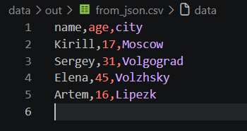
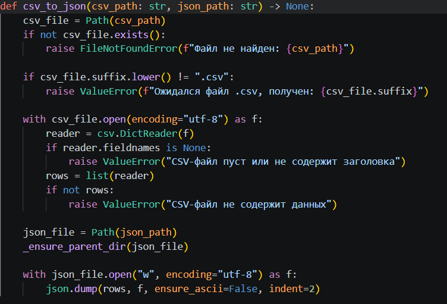
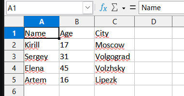
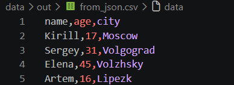
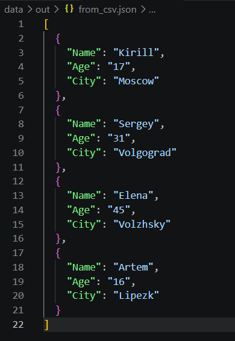
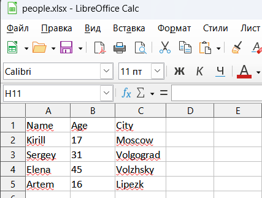

## Лабораторная работа №5 — JSON, CSV и XLSX

# Петрин Кирилл Александрович БИВТ 26-6-1

# Описание работы
Лабораторная работа посвящена разработке модулей для конвертации данных между форматами JSON, CSV и XLSX с использованием стандартной библиотеки Python и сторонней библиотеки "openpyxl". В ходе работы реализована валидация входных данных и автоматическое создание выходных каталогов.

## Задание A — JSON ↔ CSV

Модуль "json_csv.py" содержит две функции.

### Функция "json_to_csv"

Функция:
- проверяет существование входного файла;
- проверяет расширение ".json";
- читает JSON в кодировке UTF-8;
- проверяет, что корневой объект является непустым списком словарей;
- собирает названия всех ключей в порядке их первого появления;
- записывает заголовок и строки в CSV в кодировке UTF-8.

Если в одном из словарей отсутствует ключ, в соответствующую ячейку записывается пустое значение.

### Функция "csv_to_json"

Функция:
- проверяет существование входного файла;
- проверяет расширение ".csv";
- читает CSV в кодировке UTF-8;
- проверяет наличие заголовка и хотя бы одной строки данных;
- преобразует каждую строку в словарь;
- сохраняет список словарей в JSON с отступом в два пробела.

## Задание B — CSV → XLSX

Модуль "csv_xlsx.py" содержит функцию "csv_to_xlsx".

### Функция "csv_to_xls"

Функция:
- проверяет существование CSV-файла;
- проверяет расширение `.csv`;
- читает строки в кодировке UTF-8;
- создаёт книгу Excel с помощью `openpyxl`;
- добавляет строки CSV на лист `Sheet1`;
- рассчитывает ширину столбцов;
- сохраняет результат по указанному пути.

Ширина столбца вычисляется по самому длинному текстовому значению в столбце (но не менее 8 символов).

## Скриншоты работы программы

Вызовы: python -m src.lab05.json_csv, python -m src.lab05.csv_xlsx

### 1. Результат JSON → CSV

*Рис. 1. Результат преобразования JSON в CSV.*

### 2. Результат CSV → JSON

*Рис. 2. Результат преобразования CSV в JSON.*

### 3. Результат CSV → XLSX

*Рис. 3. Результат преобразования CSV в XLSX (открыт в табличном редакторе).*