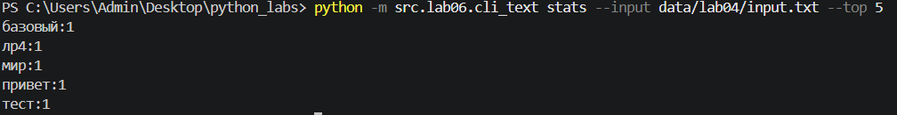
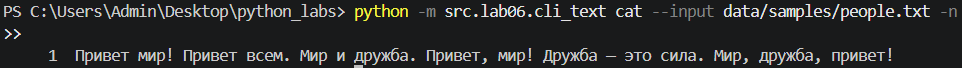
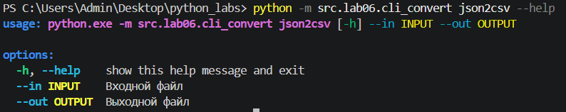
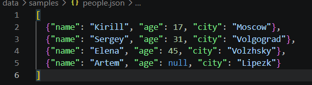
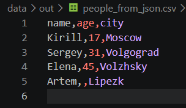
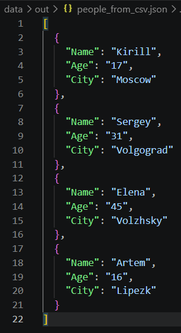
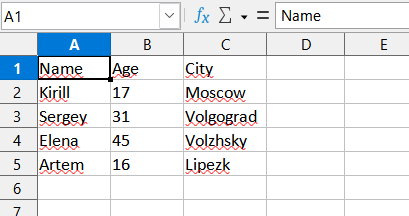
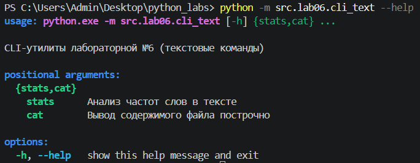
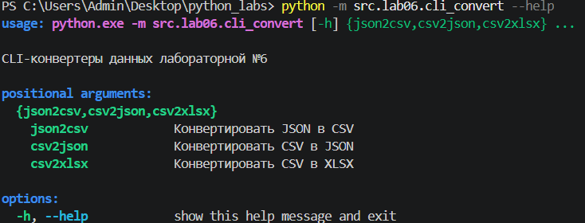

# Отчет по лабораторной работе №6
### Петрин Кирилл Александрович БИВТ 26-6-1

## Задание A — текстовые CLI-утилиты

'cli_text.py` содержит подкоманды  `stats` и `cat`.

### Подкоманда `stats`

Подкоманда подсчитывает частоты слов в текстовом файле. Для обработки
используются функции из [src/lib/text.py](../lib/text.py):

`count_freq()` — подсчёт частот;
`normalize()` — нормализация текста;
`tokenize()` — выделение слов;
`top_n()` — сортировка и выбор наиболее частых слов.

Запуск с количеством слов по умолчанию:

```powershell
python -m src.lab06.cli_text stats --input data/samples/people.txt
```

Выводит топ-5 самых часто встречающихся слов в тексте:

```powershell
python -m src.lab06.cli_text stats --input data/lab04/input.txt --top 5
```
Выводит топ-3 самых часто встречающихся слов в тексте:

```powershell
python -m src.lab06.cli_text stats --input data/lab04/input.txt --top 3
```
Пример запуска кода (вывод топ 5):

[]

Параметры:

- `--input` — обязательный путь к текстовому файлу;
- `--top` — количество слов в результате, по умолчанию `5`.

### Подкоманда `cat`

Подкоманда выводит текст без нумерации.

```powershell
python -m src.lab06.cli_text cat --input data/samples/people.txt
```

Вывод текста с нумерацией строк (флаг -n):

```powershell
python -m src.lab06.cli_text cat --input data/samples/people.txt -n
```

Пример запуска для вывода с нумерацией:



Параметры:

- `--input` — обязательный путь к входному файлу;
- `-n` — необязательный флаг нумерации строк.

## Задание B — CLI-конвертеры

Модуль `cli_convert.py` предоставляет три подкоманды. Внутри используются
функции из лабораторной работы №5:

- `json_to_csv()` из `src.lab05.json_csv`;
- `csv_to_json()` из `src.lab05.json_csv`;
- `csv_to_xlsx()` из `src.lab05.csv_xlsx`.

Для всех конвертеров обязательны параметры:

- `--in` — путь к входному файлу;
- `--out` — путь к выходному файлу.

### Подкоманда `json_to_csv`

Преобразует JSON со списком словарей в CSV:

```powershell
python -m src.lab06.cli_convert json2csv `
  --in data/samples/people.json `
  --out data/out/people_from_json.csv
```
Справка к json_to_csv



Пример для запуска подкоманды:



Результат запуска:



### Подкоманда `csv_to_json`

Преобразует CSV с заголовком в JSON-список словарей:

```powershell
python -m src.lab06.cli_convert csv2json `
  --in data/lab05/samples/people.csv `
  --out data/lab05/out/people_from_csv.json
```
Результат запуска:



### Подкоманда `csv2xlsx`

Преобразует CSV в таблицу XLSX:

```powershell
python -m src.lab06.cli_convert csv2xlsx `
  --in data/lab05/samples/people.csv `
  --out data/lab05/out/people.xlsx
```

Результат запуска:



## Справка `--help`

Справка всего CLI:

```powershell
python -m src.lab06.cli_text --help
python -m src.lab06.cli_convert --help
```

Справка отдельных подкоманд:

```powershell
python -m src.lab06.cli_text cat --help
python -m src.lab06.cli_text stats --help
python -m src.lab06.cli_convert json2csv --help
python -m src.lab06.cli_convert csv2json --help
python -m src.lab06.cli_convert csv2xlsx --help
```
Справка текстовых подкоманд:



Справка конверторов:



## Обработка ошибок

При отсутствии входного файла программы вызывают `FileNotFoundError` с понятным сообщением о пути к файлу.

Ошибки формата входных файлов и пустых файлов обрабатываются функциями из лабораторных работ №4 и №5. Ошибки обязательных аргументов и неизвестных параметров обрабатываются самим `argparse`, который выводит сообщение об ошибке и справку по использованию команды.

## Проверка работы

Для проверки были выполнены следующие сценарии:

1. `cat --input data\samples\people.txt -n` — вывод файла с номерами строк;
2. `stats --input data\samples\people.txt --top 5` — вывод пяти наиболее частых слов;
3. `json_to_csv` — конвертация JSON в CSV;
4. `csv_to_json` — конвертация CSV в JSON;
5. `csv_to_xlsx` — конвертация CSV в XLSX;
6. `--help` для общего CLI и каждой подкоманды.

Результаты конвертаций сохраняются в `data\out\`, а скриншоты запусков
находятся в `images\lab06\`.

## Зависимости

Сам CLI использует стандартный модуль `argparse`, а также `pathlib` и функции
из предыдущих лабораторных работ. Для команды `csv2xlsx` транзитивно требуется
`openpyxl`, потому что она вызывает реализацию CSV → XLSX из ЛР5.

Установка зависимостей из корня репозитория:

```powershell
python -m pip install -r requirements.txt
```