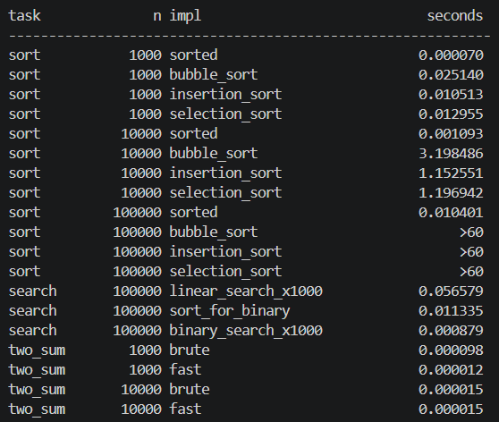

# Отчет по лабораторной работе №7

## Алгоритмы поиска

- `linear_search(nums, x)` — линейный поиск первого вхождения элемента;
- `binary_search(sorted_nums, x)` — бинарный поиск в отсортированном списке;
- `two_sum_brute(nums, target)` — поиск пары вложенными циклами;
- `two_sum_fast(nums, target)` — поиск пары за один проход со словарём.

| Алгоритм | Сложность |
|---|---|
| Линейный поиск | O(n) |
| Бинарный поиск | O(log n) |
| two_sum_brute | O(n²) |
| two_sum_fast | O(n) |

Бинарный поиск работает только с предварительно отсортированным списком.

## Алгоритмы сортировки

- `bubble_sort(nums)` — сортировка пузырьком с ранним выходом;
- `insertion_sort(nums)` — сортировка вставками;
- `selection_sort(nums)` — сортировка выбором.

| Алгоритм | Сложность |
|---|---|
| Пузырьковая сортировка | O(n²) |
| Сортировка вставками | O(n²) |
| Сортировка выбором | O(n²) |

## Проверка корректности

Запуск проверки из корня репозитория:

```bash
python -m src.lab07.check
```

Проверены:
- три квадратичные сортировки — по 100 случайных списков;
- линейный и бинарный поиск — 100 случайных наборов;
- оба решения задачи Two Sum — 100 случайных наборов;
- отсутствие изменения входного списка.

Результат проверки:

```text
bubble_sort OK: 100
insertion_sort OK: 100
selection_sort OK: 100
linear_search OK: 100
binary_search OK: 100
two_sum_brute OK: 100
two_sum_fast OK: 100
ВСЕ ПРОВЕРКИ ПРОЙДЕНЫ!
```

## Бенчмарк

Результаты выводятся в консоль и сохраняются в `data/lab07/bench.csv`.
Запуск из корня репозитория:

```bash
python -m src.lab07.bench
```

### Сортировки

| Размер n | sorted | bubble_sort | insertion_sort | selection_sort |
|---|---|---|---|---|
| 1 000 | 0.000070 с | 0.025140 с | 0.010513 с | 0.012955 с |
| 10 000 | 0.001093 с | 3.198486 с | 1.152551 с | 1.196942 с |
| 100 000 | 0.010401 с | > 60 с | > 60 с | > 60 с |

Квадратичные сортировки для `n = 100 000` ограничены отметкой `> 60`, поскольку их выполнение занимает слишком много времени.

### Поиск

Замер выполнен для списка из 100 000 элементов и 1 000 запросов.

| Реализация | Время |
|---|---|
| Линейный поиск (1000 запросов) | 0.056579 с |
| Сортировка списка | 0.011335 с |
| 1000 бинарных поисков | 0.000879 с |

Бинарный поиск требует предварительной сортировки. Однако даже с учетом времени на сортировку (0.0113 с + 0.0008 с = 0.0121 с), подход с бинарным поиском оказывается почти в 5 раз быстрее, чем 1000 раз пройтись линейным поиском по всему списку (0.0565 с).

### Two Sum

| Размер n | two_sum_brute | two_sum_fast |
|---|---|---|
| 1 000 | 0.000098 с | 0.000012 с |
| 10 000 | 0.000015 с | 0.000015 с |

На массиве из 1000 элементов решение со словарём оказалось быстрее. На 10 000 элементов оба алгоритма показали одинаковое время (0.000015 с). Это связано с особенностью генерации тестов: искомая пара элементов оказалась в самом начале массива, поэтому вложенный цикл `two_sum_brute` сработал за минимальное время (благодаря раннему выходу). В худшем случае `two_sum_fast` всё равно масштабируется линейно O(n), а перебор — квадратично O(n²).

## Вывод

При увеличении размера списка с 1 000 до 10 000 элементов пузырьковая сортировка замедлилась в ~127 раз (с 0.025 до 3.19 секунд): это соответствует квадратичной сложности O(n²). Для `sorted` (Timsort) рост составил около 15 раз, что отражает асимптотику O(n log n). На `n = 100 000` квадратичные сортировки не укладываются в 60 секунд, что подтверждает теоретические оценки из лекций.

Бинарный поиск сам по себе очень быстрый, но применим только к отсортированному списку. Как показал бенчмарк, при тысяче запросов стоимость сортировки быстро окупается, и бинарный поиск становится значительно выгоднее линейного. Проверка `check.py` подтвердила корректность всех алгоритмов: расхождений на 100 случайных тестах для каждого набора не обнаружено.

## Результаты работы бенчмарка

Вывод в консоли:



Получившийся csv файл:

.png)


## Типичные ошибки (и как их избежать)

1. **Изменение исходного списка** — все сортировки должны начинаться с `arr = list(nums)`.
2. **Неверные границы в бинарном поиске** — использовать `while lo <= hi`, `mid = (lo + hi) // 2`, не забывать про `+1`/`-1` при сдвиге границ; проверять на списках из 1 и 2 элементов, а также на отсутствующем `x`.
3. **Отсутствие раннего выхода в пузырьке** — флаг `swapped` обязателен.
4. **Нечестные замеры** — все алгоритмы должны получать одни и те же данные (один `random.seed(42)`), иначе сравнение некорректно.
5. **Игнорирование времени сортировки для бинарного поиска** — в бенчмарке поиска отдельной строкой замеряется `sorted(data)`, иначе выгода бинарного поиска завышена.
6. **Квадратичные сортировки на `n = 100 000` без ограничения** — бенчмарк может «зависнуть» на минуты; нужно либо ограничить время, либо сразу помечать `>60`.
7. **`check_two_sum` без проверки корректности пары** — недостаточно сравнить «оба нашли» или «оба None»; нужно проверить, что сумма элементов по индексам действительно равна `target`, и что `i < j`.
8. **`linear_search` без обработки `ValueError` от `list.index`** — при отсутствии элемента `list.index` бросает исключение, а `linear_search` должен вернуть `-1`.
9. **Пустые списки и списки из одного элемента** — все функции должны корректно работать на этих граничных случаях.